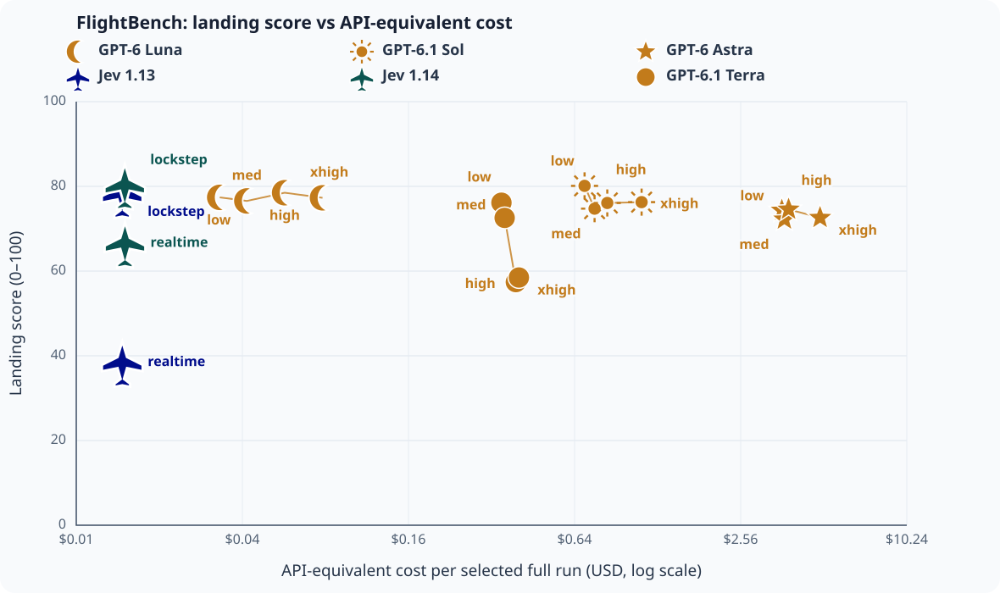

# FlightBench comparison

Except the explicitly selected Luna high retry below, each row uses the highest-scoring completed flight for seeds 42, 101 and 202, separately by model, effort and mode. A tie uses the lower seed. Jev 1.13 uses its new three-flight repeat in each mode when supplied; superseded trials remain in the JSON provenance. Max is excluded.

**Retry disclosure:** 19 interrupted controller/infrastructure attempts were archived for the original campaign; this is not a claim of only three total attempts per group. Luna high uses the successful seed42 retry selected by the user (78.507); this is not best-of-three attempts. After the original three failures, retries included a preflight HTTP429, one completed runway excursion and one timeout before the successful seed42 retry; seed101 was cancelled and seed202 was not started. All original and retry evidence is retained.

| Controller | Score and result | Sim time and wall time (s) | Calls | Mean latency per call (s) | Latency vs Jev | Input / output tokens | Est. API cost | Cost vs Jev |
| --- | ---: | --- | ---: | ---: | ---: | ---: | ---: | ---: |
| GPT-6.1 Sol (low) · lockstep | 80.129 · landed | 66.7 / 470.1 (lockstep) | 134 | 3.493 | 14.6× | 316,387 / 6,269 | $0.695464 | 46.4× |
| GPT-6.1 Sol (medium) · lockstep | 74.731 · landed | 69.9 / 456.3 (lockstep) | 140 | 3.244 | 13.5× | 331,291 / 9,770 | $0.756148 | 50.4× |
| GPT-6.1 Sol (high) · lockstep | 76.087 · landed | 69.8 / 602.7 (lockstep) | 140 | 4.289 | 17.9× | 331,297 / 17,811 | $0.840704 | 56.1× |
| GPT-6.1 Sol (xhigh) · lockstep | 76.279 · landed | 69.8 / 1975.4 (lockstep) | 140 | 14.094 | 58.9× | 331,264 / 46,525 | $1.119752 | 74.7× |
| GPT-6 Astra (low) · lockstep | 74.310 · landed | 69.7 / 731.4 (lockstep) | 140 | 5.209 | 21.8× | 331,023 / 5,997 | $3.610080 | 240.8× |
| GPT-6 Astra (medium) · lockstep | 72.225 · landed | 71.2 / 601.2 (lockstep) | 143 | 4.182 | 17.5× | 338,196 / 6,120 | $3.687960 | 245.9× |
| GPT-6 Astra (high) · lockstep | 74.565 · landed | 69.8 / 797.2 (lockstep) | 140 | 5.678 | 23.7× | 330,976 / 10,175 | $3.818510 | 254.7× |
| GPT-6 Astra (xhigh) · lockstep | 72.604 · landed | 69.7 / 1665.9 (lockstep) | 140 | 11.882 | 49.6× | 331,324 / 33,045 | $4.965490 | 331.1× |
| GPT-6 Luna (low) · lockstep | 77.402 · landed | 63.6 / 289.7 (lockstep) | 128 | 2.248 | 9.4× | 302,479 / 5,725 | $0.033110 | 2.2× |
| GPT-6 Luna (medium) · lockstep | 76.552 · landed | 67.9 / 378.1 (lockstep) | 136 | 2.762 | 11.5× | 321,391 / 18,753 | $0.041516 | 2.8× |
| GPT-6 Luna (high) · lockstep | 78.507 · landed | 68.7 / 887.7 (lockstep) | 138 | 6.414 | 26.8× | 326,287 / 48,584 | $0.056921 | 3.8× |
| GPT-6 Luna (xhigh) · lockstep | 77.306 · landed | 69.8 / 1070.9 (lockstep) | 140 | 7.629 | 31.9× | 331,302 / 89,989 | $0.078125 | 5.2× |
| Jev 1.13 · lockstep | 78.426 · landed | 64.7 / 28.0 (lockstep) | 130 | 0.212 | 0.9× | 349,209 / — | $0.014667 | 1.0× |
| Jev 1.14 · lockstep | 80.462 · landed | 66.4 / 32.7 (lockstep) | 133 | 0.239 | 1.0× | 357,023 / — | $0.014995 | 1.0× |
| Jev 1.13 · realtime | 38.577 · landed | 65.5 / 65.6 (realtime) | 130 | 0.229 | 1.0× | 349,549 / — | $0.014681 | 1.0× |
| Jev 1.14 · realtime | 66.719 · landed | 66.5 / 66.6 (realtime) | 133 | 0.215 | 0.9× | 357,479 / — | ≥$0.015014† | ≥1.0× |

† Realtime flights can finish with an outstanding request. These prices are **lower bounds**, not complete costs. The graph plots the recorded lower bound; this table marks the uncertainty. Ratios use the complete Jev 1.14 lockstep flight as reference, with lower-bound ratios marked ≥. Codex costs are API-equivalent estimates, not subscription charges; no flight cost is scaled.

The original lockstep source and October 26 realtime source differ only by audited validation guards; see [source transition](../../local-model-runtime/scoring-v2-realtime-2026-10-26/source-transition.md). Modes and measurement dates remain distinct. Only canonical scoring configuration `82684d68cfb2dc37bd08ee8a1e0072d88d31a3190483eb89b39e523a0b8a7b80` is accepted.



[PNG version](landing-score-vs-api-cost.png) · [machine-readable results](results.json)

Reproduce the current comparison from the repository root:

```sh
.venv/bin/python examples/build_v2_publication.py   --submissions leaderboard/campaigns/2026-10-22-scoring-v2/submissions   --realtime-submissions leaderboard/campaigns/2026-10-26-realtime/submissions --jev113-submissions leaderboard/campaigns/2026-10-26-jev113-repeat/submissions --jev113-realtime-submissions leaderboard/campaigns/2026-10-26-realtime-repeat2/submissions   --output docs/evaluations/2026-10-22-scoring-v2
```
