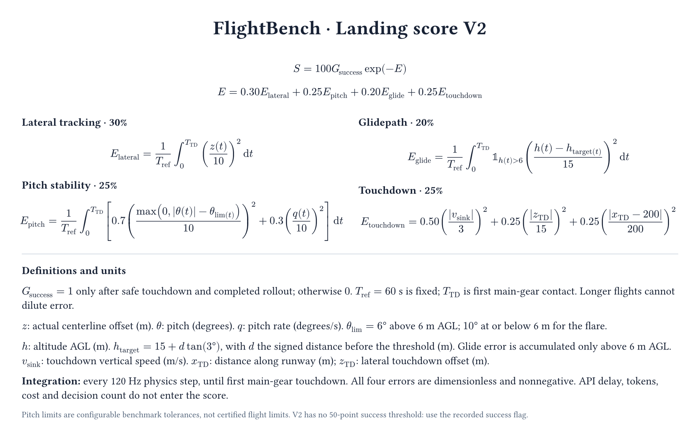
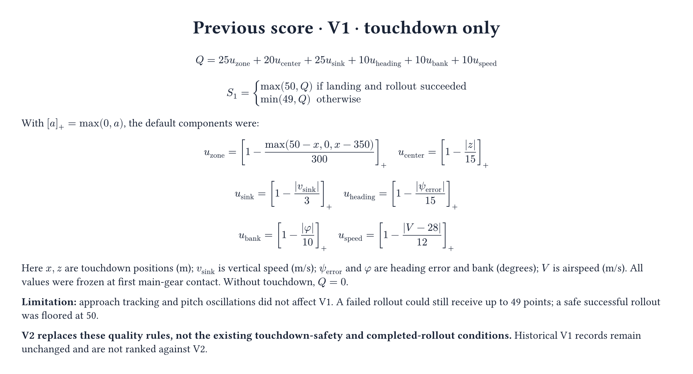

# Landing score versions

V2 follows [the requested specification](../../scoring_v2.md). The action/observation protocol
remains `flightbench-v1`; scoring is independently labeled `v2`. Public V2 comparisons require
identical full scoring configuration hashes and canonical default constants.

## V2 (new runs)



Successful means safe first main-gear contact followed by completed rollout, not exceeding a
score threshold. Failure scores zero. Errors integrate each 1/120-second physics step until
first main-gear contact; actual centerline offset is used without the observation deadband.
API latency, costs and decision counts never enter the formula. Full integrals and configuration
are stored so the validator can recompute the published score.

### Calibration and limits

Defaults are configurable `ScoringConfig` fields. Approach pitch tolerance is 6 degrees;
flare tolerance is 10 degrees below 6 m AGL. Pitch-rate normalization remains 10 degrees/s.
These are benchmark calibration choices, **not certified operating limits**.

The [FAA Airplane Flying Handbook, Chapter 9, pp. 9-8–9-9](https://www.faa.gov/sites/faa.gov/files/regulations_policies/handbooks_manuals/aviation/airplane_handbook/10_afh_ch9.pdf)
describes a gradual roundout roughly 10–20 ft above ground, not a universal pitch-angle limit.
The installed [JSBSim c172x model](https://github.com/JSBSim-Team/jsbsim/blob/3b25f25e49b42d0489c04ac805674fc1450ca579/aircraft/c172x/c172x.xml)
models a 1982 C172P for educational use. Its unloaded gear/tail-skid geometry implies tail
contact around 11.5 degrees; gear compression affects this, so it is not a certified safety limit.

Representative archived successful flights had median absolute approach pitch 1.54–2.95 degrees,
flare pitch 3.84–4.08 degrees, and approach pitch rate 0.72–1.06 degrees/s. Transient large rates
still receive a quadratic penalty. The fixed 60-second reference is a round benchmark scale:
easy starts 1500 m before the threshold at about 33.44 m/s, giving about 50.8 seconds of nominal
travel to the 200 m touchdown reference before flare deceleration. Seven archived successes
reached main-gear touchdown at about 56–63.5 seconds. It is never replaced by each flight's duration.

The existing 3-degree glide target is 15 m above the threshold; signed distance continues beyond
the threshold. Glide error is disabled at/below 6 m AGL for the flare. The 200 m longitudinal
touchdown target is a scoring reference, not a universal ideal touchdown location.

## V1 (historical)



V1 is preserved with `ScoringConfig(version="v1")`. Missing scoring-version fields in old
submissions mean V1, not V2. No historical score has been retrospectively rewritten.

## Rebuild formula figures

```sh
typst compile --format png --ppi 150 docs/scoring/scoring-v2.typ docs/scoring/scoring-v2.png
typst compile --format png --ppi 150 docs/scoring/scoring-v1.typ docs/scoring/scoring-v1.png
```
