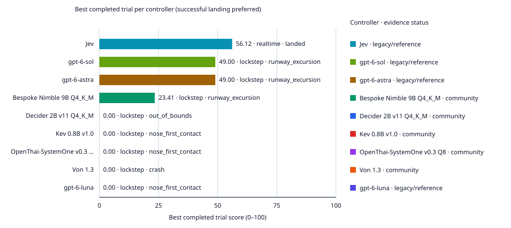

# FlightBench community leaderboard

Realtime and lockstep are evaluation modes over the same architecture-neutral controller roster. Community results are self-reported until independently reproduced.

| Controller | Status | Lockstep success / score | Realtime success / score | p50 / p95 realtime latency | Evidence |
| --- | --- | ---: | ---: | ---: | --- |
| [Decider 2B v11 Q4_K_M](https://github.com/Mapika/decider) | community | 0/5 (0%) / 0.00 | 0/5 (0%) / 0.00 | 4274.1 / 5768.3 ms | [submission](submissions/decider-2b-v11-q4/submission.json) |
| [Kev 0.8B v1.0](https://github.com/jaredpalmer/kev) | community | 0/5 (0%) / 0.00 | 0/5 (0%) / 0.00 | 2198.9 / 3573.1 ms | [submission](submissions/kev-0.8b-v1/submission.json) |
| [Bespoke Nimble 9B Q4_K_M](https://ollama.com/library/nimble) | community | 0/5 (0%) / 23.41 | 0/5 (0%) / 0.00 | 13767.6 / 15349.3 ms | [submission](submissions/nimble-9b-q4/submission.json) |
| [OpenThai-SystemOne v0.3 Q8](https://huggingface.co/iapp/OpenThai-SystemOne-Ollama) | community | 0/5 (0%) / 0.00 | 0/5 (0%) / 0.00 | 1315.8 / 1383.2 ms | [submission](submissions/openthai-v0.3-q8/submission.json) |
| [Von 1.3](https://github.com/wfzyx/von) | community | 0/5 (0%) / 0.00 | 0/5 (0%) / 0.00 | 4049.9 / 5480.4 ms | [submission](submissions/von-1.3/submission.json) |
| [Jev](https://github.com/AlperKartkaya/FlightBench) | legacy/reference (not v1) | — | 1/1 (100%) / 56.12 | 301.0 / 374.3 ms | [submission](historical/manifest.json) |
| [gpt-6-luna](https://github.com/AlperKartkaya/FlightBench) | legacy/reference (not v1) | 0/5 (0%) / 0.00 | — | — | [submission](historical/manifest.json) |
| [gpt-6-sol](https://github.com/AlperKartkaya/FlightBench) | legacy/reference (not v1) | 0/5 (0%) / 49.00 | — | — | [submission](historical/manifest.json) |
| [gpt-6-astra](https://github.com/AlperKartkaya/FlightBench) | legacy/reference (not v1) | 0/5 (0%) / 49.00 | — | — | [submission](historical/manifest.json) |

## Graphs

| Mode | Latency vs score | Provider cost vs score |
| --- | --- | --- |
| Lockstep | [Graph](lockstep-latency-score.svg) | [Graph](lockstep-cost-score.svg) |
| Realtime | [Graph](realtime-latency-score.svg) | [Graph](realtime-cost-score.svg) |

[Mode delta](mode-delta.svg) · [Best completed trial per controller](best-of.svg)

A failed trial is not a successful landing. Legacy Jev/Codex references retain their original protocols and rates; absent mode evidence is never invented. Historical Codex costs are API-price equivalents, not subscription charges; Jev uses a logged-character token estimate.
Historical references are curated records, not a new evaluation cohort. In particular, Jev contributes one selected successful run: 1/1 here is not its overall historical success rate.

## Submit a result

1. Evaluate the same controller in lockstep and realtime with declared seeds.
2. Generate `submission.json` plus the gzip evidence records with `build_submission`.
3. Add them under `leaderboard/submissions/<controller>/` and open a leaderboard PR.
4. Run `python -m flightbench.leaderboard validate leaderboard/submissions/<controller>/submission.json`.

CI checks schema, metrics, evidence size, and SHA-256 integrity only. It never runs submitted controllers or uses provider secrets. New entries remain **community / self-reported** until maintainers reproduce them in a trusted environment.

Unknown provider cost stays unknown. A zero local provider fee excludes hardware and energy unless provenance explicitly says otherwise.
